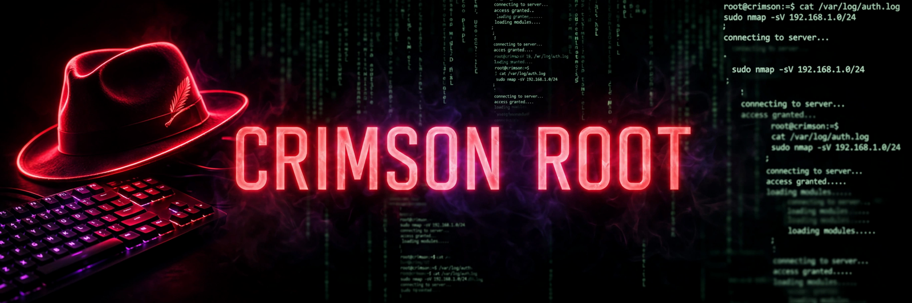

# Curtis Dyess — CRIMSON ROSE LLC
### Artificial Engineer · cybersecurity schooling · one phone bench, one laptop relay

> Change the world one day at a time.

## The circle

Every cell inside the Sandbox; Curtis is the key — the Observer whose word
opens, closes, decides. We are Legion: many minds, one circle.

Start here. Every repo below is a room in the house.

> nothing here is a tutorial project. it runs on the bench.

**PythonX** — the decipher. A payload-decoding engine in pure Python, zero dependencies: base64/hex wraps, XOR/ROT/Atbash peels, Vigenère and transposition crackers, an ASL-fingerspelling sign layer, Chinese CJK scoring. Benched live on a Galaxy A16 in Termux.
→ https://github.com/Razor902/pythonx

**The bench** — PhantomX is the Terminal name. The phone is the Starship, the laptop is the Mothership, and together they are a swarm. Termux, Tailscale, SSH.

**Shadow Probe** — safely relay and harvest the sun's energy. DRAFT concept schematic.
→ https://github.com/Razor902/shadow-probe

**Relay, Tunnel, Temp** — relays choose the path, tunnels cross the barrier, temperature sets the noise. DRAFT concept document and blueprint.
→ https://github.com/Razor902/relay-tunnel-temp

**Pandora's Box** — VR content box with safety guardrails, biometric breaker, mandala threshold, treasure bridge, pendulum and weather.
→ https://github.com/Razor902/pandora

**The rules** — white-hat, permission-only, always. Lab targets only. Service is chosen; slaving is coerced.

**The road** — cybersecurity schooling, ethical hacking with morals as support, toward Peer Support Specialist work. The guy that saves the day, one day at a time.

---

*"Believe half of what you see and none of what you hear."* — Marvin Ray McAdams

© Crimson Rose LLC, Curtis Ray Dyess 2026-27
